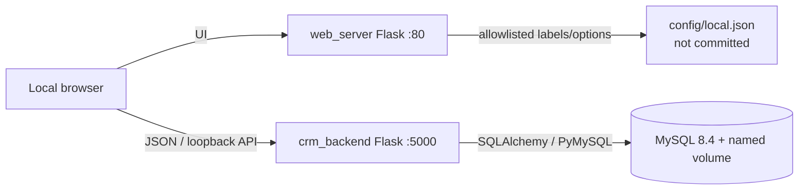
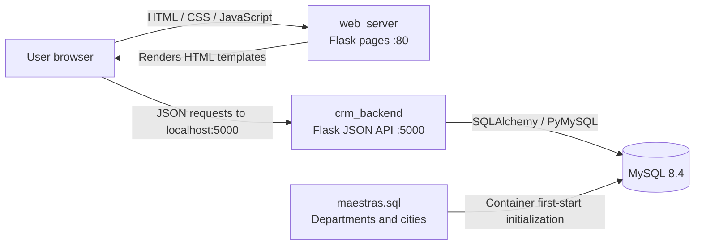

# CRM Application — Current Architecture Audit

> Audit scope: static inspection of the repository snapshot supplied for review. This document describes the code as found; it is not a statement that the application has been deployed or runtime-tested.
>
> Privacy note: this document intentionally uses generic terminology. Business-specific labels, product catalogs, distributor names, and brand-specific wording found in the source are not reproduced here.

## 1. Repository inventory

The supplied archive contains 30 files:

| Area | Files | Responsibility |
|---|---|---|
| Backend | `backend_api.py` | Flask JSON API, SQLAlchemy models, database initialization |
| Web server | `web_server.py` | Flask page rendering and static-file delivery |
| Templates | `index.html`, `welcome.html`, `form.html`, `formlist.html` | Main page, welcome page, registration form, search/list page |
| Frontend logic | `scripts/api.js`, `scripts/form.js`, `scripts/formlist.js`, `scripts/main.js` | HTTP requests, dynamic referral blocks, search/detail/delete UI |
| Styling | `styles/styles.css` | Global styles and form/list presentation |
| Database initialization | `mysql-init-files/maestras.sql` | Department and city reference data |
| Sample data | `data/example_clients.sql`, `data/example_referidos.sql`, `data/sample_data.py` | Example records and generator |
| Deployment | `docker-compose.yml`, `entrypoint_dev.sh`, `entrypoint_web_dev.sh`, `requirements.txt` | Local container orchestration and startup |
| Other | `README.md`, `.gitignore`, `LICENCE.txt`, `imgs/*` | Documentation, ignore rules, license, diagrams/mockup |

## 2. High-level architecture (after Phase 1 changes)

The current working copy has received a security/configuration baseline. The browser still calls the API directly, but the API host port is bound to loopback only. MySQL is internal to the Compose network and uses a named data volume. The public form presentation options are loaded from a local ignored JSON file through an allowlisted `/app-config` response.

## 3. Original architecture snapshot

The initial supplied archive used a three-service Docker Compose deployment:

The application is a small three-service Docker Compose deployment:

- `web_server.py` renders the HTML templates and serves CSS/JavaScript from mounted directories.
- Browser-side JavaScript calls the API directly. The API base URL remains `http://localhost:5000`; the Compose host binding is now loopback-only.
- `backend_api.py` defines the SQLAlchemy models and REST-like endpoints.
- MySQL stores customer/form records, referrals, departments, and cities.
- The MySQL initialization script creates and populates only the department and city reference tables. The API calls `db.create_all()` when run as the main module to create the application tables.

## 3. Data model

### `departamentos`

- `id`: integer primary key.
- `nombre`: required string.

### `ciudades`

- `id`: integer primary key.
- `nombre`: required string.
- `departamento_id`: required foreign key to `departamentos.id`.

### `clientes`

- `id_formulario`: integer primary key, configured as an identity column.
- `numero_documento`, `tipo_documento`, `nombre_completo`: required identity/name fields.
- `departamento_id`, `ciudad_id`: required integers, but neither is declared as a foreign key in this model.
- `direccion`, `telefono`, `promotor`: required fields in the model.
- `horario`, distributor contact fields, and start/expiration dates: optional fields.
- No unique constraint on `numero_documento` is declared in the inspected model.

### `referidos`

- `id`: integer primary key with autoincrement.
- Name, phone, location, relationship, and several optional profile fields.
- `cliente_id`: required foreign key to `clientes.id_formulario`.
- Department and city identifiers are not declared as foreign keys.
- A legacy brand-specific field exists in the table/model. It should be handled through a backward-compatible migration and configurable field/label strategy rather than casually renamed or dropped.

### Relationships

The `Referido.cliente_id` foreign key links referrals to a customer/form. The ORM models do not declare SQLAlchemy `relationship()` properties or database cascade behavior. The customer DELETE endpoint manually deletes referrals before deleting the customer.

## 4. API surface found in `backend_api.py`

| Method | Route | Current purpose |
|---|---|---|
| GET | `/departamentos` | Return departments |
| GET | `/ciudades` | Return cities grouped by department ID |
| GET | `/form_number` | Calculate a proposed next form number from the current maximum ID |
| POST | `/clientes` | Insert one customer/form |
| GET | `/clientes/<id_formulario>` | Return one customer and its referrals |
| GET | `/clientes/documento/<numero_documento>` | Return forms matching an exact document number |
| DELETE | `/clientes/<id_formulario>` | Delete a customer and its referrals |
| POST | `/referidos` | Insert one referral |
| DELETE | `/referidos/<referido_id>` | Delete one referral |

No GET `/clientes` list endpoint, customer update endpoint, or referral update endpoint was found. There is no single endpoint to create/update a customer and its referral collection as one transaction.

## 5. Registration flow as implemented

1. `scripts/form.js` calls `/form_number` and loads department/city reference data.
2. The user enters customer fields in `form.html` and dynamically adds referral blocks.
3. `submitForm()` manually extracts customer fields and referral fields from the DOM.
4. The browser posts the customer to `/clientes`.
5. After the customer insert succeeds, the browser posts each referral separately to `/referidos`, sequentially.
6. The API commits each request independently.

This means the customer and all referrals are not one atomic unit. A failure after the customer insert or after some referral inserts can leave incomplete data.

The customer form also contains two business-configurable selection fields that are not included in the customer payload and have no corresponding fields in the inspected `Cliente` model. Their values are therefore not persisted by the current submission flow.

## 6. Search, detail, and deletion flow

- `scripts/formlist.js` searches by exact document number using `/clientes/documento/<number>`.
- The page has no all-record listing behavior. The frontend helper has a no-filter path that calls GET `/clientes`, but the API does not define that route.
- Detail viewing fetches `/clientes/<id>` and builds a modal.
- Deletion asks for browser confirmation and calls DELETE `/clientes/<id>`.
- The detail UI is read-only. The referral-level Save/Edit controls in the registration form only toggle DOM `disabled` state; they do not persist changes to the database.

## 7. Configuration and deployment — current working copy

- `docker-compose.yml` defines MySQL, API, and web services.
- MySQL now uses the named `mysql_data` volume; it is not published to a host port.
- API and web host ports are bound to `127.0.0.1` (`5000` and `8080` respectively).
- MySQL has a healthcheck; the API waits for it to become healthy.
- Flask debug mode is controlled by `FLASK_DEBUG` and defaults to false.
- Database connection settings are read from environment variables. `MYSQL_PASSWORD` is mandatory; the public source contains no fallback password.
- `.env.example` contains placeholders; `.env` is ignored by Git.
- `config/local.example.json` is a generic template. `config/local.json` contains local-only form labels/options and is ignored by Git.
- `/app-config` exposes only approved presentation fields; the web server no longer has a catch-all route capable of serving arbitrary files from `/root`.
- Explicit `.html` aliases are retained so existing navigation links continue to work.
- Dependencies are still installed at container startup; built/pinned application images remain future work.
- The frontend still calls `http://localhost:5000`; this is suitable only for the selected one-computer local deployment.
- There is still no migration framework or automated test suite.

## 8. Phase 1 implementation and verification limits

- Python syntax compilation passed for `backend_api.py` and `web_server.py`.
- JavaScript syntax checks passed for `scripts/config.js`, `scripts/form.js`, and `scripts/api.js`.
- Static scan of the public source working copy found none of the known exposed password/business strings (the ignored local config intentionally retains the owner's existing form choices).
- Docker, MySQL, and Flask runtime dependencies were not available in the execution environment; Compose validation, container startup, database initialization, browser behavior, and end-to-end workflows were not executed.
- The archive does not include `.git` history. The audit cannot determine the current remote branch state, commit history, or whether the supplied snapshot matches the latest GitHub commit. Previously committed credentials remain exposed in Git history until rotated; rewriting history is a separate coordinated operation.
